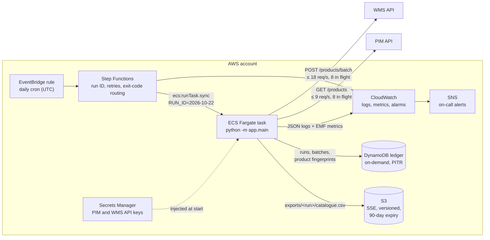
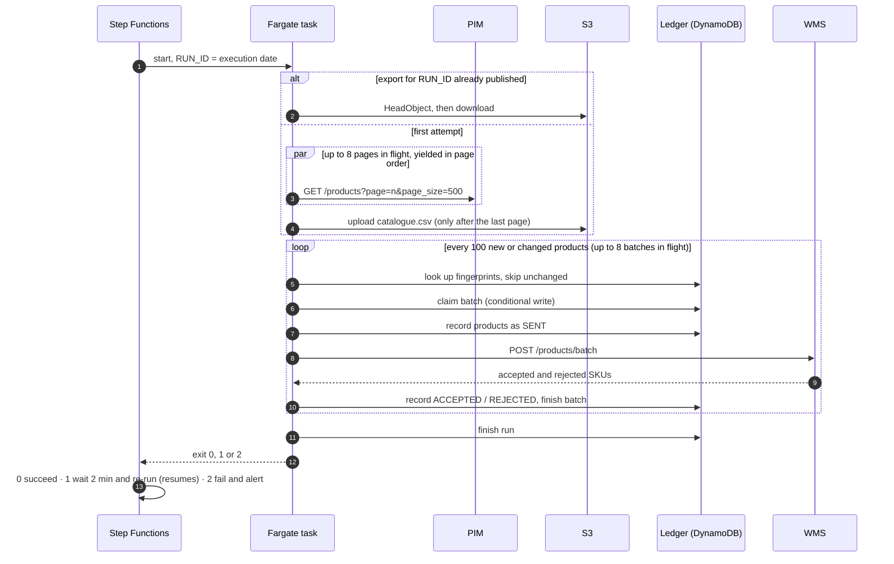
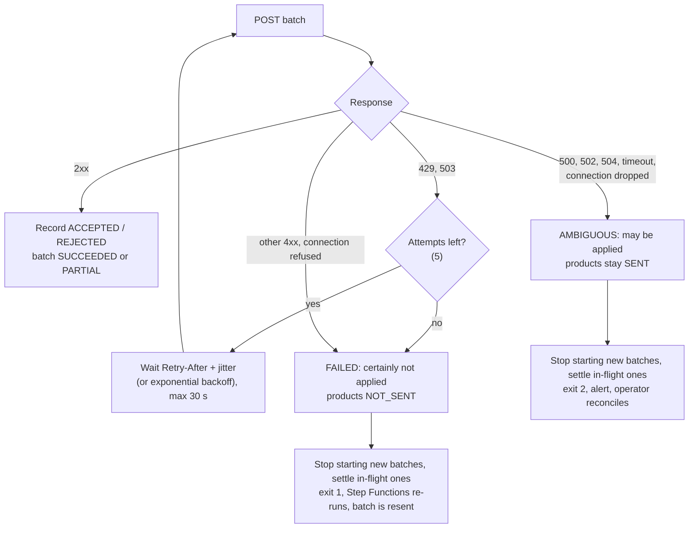

# Architecture

Daily synchronisation of the product catalogue from the PIM to the WMS, redesigned for 250,000 products today and
1,000,000 within 18 months, a 30-minute run window, 90-day retention of the original export, and the Warehouse
team's rule that **the same product must never be sent twice**.

Interpretations of ambiguous requirements are in [ASSUMPTIONS.md](ASSUMPTIONS.md) (A1–A12). Work not finished is in
[UNFINISHED.md](UNFINISHED.md).

## 1. Summary

The sync is one scheduled container task with two stages:

1. **Export.** Stream the PIM into a CSV and publish it to S3 under `exports/<run-id>/catalogue.csv` only when complete.
2. **Sync.** Read that file, skip products the WMS already has in identical form, and send the rest in batches of 100.

The two stages share a DynamoDB **ledger** that records every batch and every product. Both APIs are called
concurrently, but each through one shared rate limiter set just below its documented limit.

The design rests on two observations:

- **Throughput is set by the two APIs' rate limits, not by compute.** The WMS accepts at most 20 requests/s. At
  1M products that is 10,000 batches, or at least 8.3 minutes, however many machines send them. One task that keeps
  the APIs saturated is as fast as a fleet of workers, and far simpler to keep correct.
- **The duplicate rule is the hardest requirement, and the WMS gives no help with it.** There is no idempotency key
  and no lookup endpoint. Every design choice protects the rule: a deterministic run ID, a complete snapshot before
  sending, a ledger write before every send, and never resending an outcome that cannot be proven.

| Measured against the supplied mocks (250,000 products, real HTTP) | Result |
|---|---|
| Full export, 500 pages | 97 s |
| Full sync, 2,500 batches | 183 s (≈ 13.7 batches/s; ~15% of mock responses are throttles) |
| Re-trigger of a finished run | nothing sent, 1.7 s |
| Next day, unchanged catalogue | nothing sent; 109 s, almost all of it the PIM export |
| Projected first full load at 1M (×4) | ≈ 19 min (export ≈ 6.5 min + sync ≈ 12 min) |

## 2. Architecture diagram

Locally the same code runs with a folder in place of S3 and SQLite in place of DynamoDB, selected by environment
variables (`STORAGE_BACKEND`, `SYNC_LEDGER_BACKEND`). The DynamoDB ledger is tested against moto's in-memory
DynamoDB.

## 3. Why this architecture

| Option considered | Verdict | Reason |
|---|---|---|
| **One Fargate task, concurrent I/O within rate limits, orchestrated by Step Functions** | **Chosen** | Saturates both API limits from one process. One writer per run keeps ordering and ledger logic simple. Step Functions adds retries, exit-code routing and an audit trail without custom code. |
| SQS queue of batches + horizontally scaled workers | Rejected for now | Adds no throughput, because the WMS limit is the ceiling. It needs a distributed rate limiter, at-least-once message delivery on top of a no-duplicates rule, visibility timeouts that can redeliver an in-flight POST, and a finalisation step. The ledger and conditional claims already allow it later if the WMS limit is raised. |
| AWS Lambda | Rejected | A run takes 3–20 minutes and Lambda stops at 15. Splitting the run across invocations recreates the coordination problems of the SQS option. |
| AWS Batch / Glue | Rejected | Built for compute-heavy or data-heavy jobs. This job is I/O-bound at about 20 requests/s and needs neither. |
| Lambda/ECS triggered directly by EventBridge (no Step Functions) | Rejected | The task's exit code would be ignored, with no safe automatic resume and no execution history. |

## 4. Major components

| Component | Responsibility | Code |
|---|---|---|
| Orchestration | Daily trigger; one stable run ID per execution; re-runs exit code 1; stops and alerts on exit code 2 | `terraform/orchestration.tf` |
| CLI | Runs export then sync, logs the summary, emits metrics, maps outcomes to exit codes | `app/main.py` |
| PIM client | Reads pages concurrently and yields them in order; validates pagination; retries every temporary failure (reads are safe to repeat) | `app/clients/product_api.py` |
| WMS client | Sends one batch; retries only responses that prove the batch was not applied | `app/clients/warehouse_api.py` |
| HTTP helpers | Thread-safe rate limiter; retry loop; `Retry-After` with jitter, capped at 30 s | `app/clients/http_utils.py` |
| Export service | Streams the PIM to CSV, drops duplicate SKUs, publishes when complete, reuses an existing export | `app/services/catalogue_export.py` |
| Sync service | Transform, fingerprint, skip unchanged, batch, send concurrently, record every outcome | `app/services/warehouse_sync.py` |
| Ledger | Runs, batches and per-SKU delivery records; conditional batch claims | `app/services/sync_ledger.py` (SQLite), `dynamodb_sync_ledger.py` |
| Storage | Local folder or S3 with the same interface | `app/storage/s3.py` |
| Observability | JSON logs; CloudWatch Embedded Metric Format | `app/observability.py` |

## 5. Execution flow

1. **Run ID.** Step Functions derives `RUN_ID` from the execution's start date, or takes `runId` from the
   execution input for a manual run. Every attempt in an execution therefore resumes the same run, even one that
   crosses midnight.
2. **Export.**
   - If `exports/<run-id>/catalogue.csv` exists, it is reused. A fresh container downloads it.
   - Otherwise page 1 reports the catalogue `total`, and the remaining pages are fetched concurrently and written
     in page order to `catalogue.csv.partial`.
   - Duplicate SKUs are dropped, keeping the first occurrence.
   - After the last page, the file is uploaded under its final key and renamed locally.
3. **Sync.**
   - The CSV is streamed and each row transformed to the WMS format.
   - Every 100 products are looked up in the ledger, and those already delivered in identical form are dropped.
   - The rest are grouped into batches of 100. Each batch is claimed and its products recorded as `SENT`, then it
     is posted by a worker thread.
   - Up to 8 batches are in flight at once. Outcomes are recorded as the POSTs complete.
4. **Finish.**
   - The run is marked `COMPLETED`, `COMPLETED_WITH_REJECTIONS` or `FAILED`.
   - Metrics are emitted, and the exit code tells Step Functions what to do next.

## 6. Data flow

| Data | Where | Format and size at 1M products | Lifetime |
|---|---|---|---|
| PIM pages | Memory only, at most 8 pages in flight | JSON, 500 products per page | Seconds |
| Export being written | Task disk: `/tmp/catalogue-exports/<run>/catalogue.csv.partial` | CSV, ≈ 65 MB | Until published |
| Retained export | `s3://<bucket>/exports/<run>/catalogue.csv` | CSV, ≈ 65 MB | 90 days (lifecycle rule) |
| Batch payloads | Memory only, at most 8 batches in flight | JSON, 100 products | Seconds |
| Run record | DynamoDB `(<run>, RUN)` | status, export path, error | Indefinite |
| Batch record | DynamoDB `(<run>, BATCH#000001)` | status, SKUs, accepted, rejected with reasons, error | Indefinite (TTL is a follow-up) |
| Product record | DynamoDB `(PRODUCT#<sku>, STATE)` | SHA-256 fingerprint, status, last run | Indefinite (one per SKU, ≈ 1M items) |

Memory stays flat with catalogue size. The only per-product state held in memory is the set of exported SKUs
used to drop duplicates, about 70 MB at 1M products.

The transformation maps `id → sku`, `name → description`, `price → selling_price`, `category → category_code`,
`currency → currency` and `updated_at → source_updated_at`. A row with a missing field or an invalid price stops the
run (ASSUMPTIONS.md A8).

## 7. Failure and retry flow

Every WMS failure is sorted by one question: **could the warehouse have applied this batch?**

| Failure | Where handled | Behaviour |
|---|---|---|
| PIM 429 / 5xx / timeout / network error | `request_with_retry` | Retried up to 5 times with backoff; GETs are safe to repeat |
| PIM still failing | Export | Export fails; nothing is published; exit 1; the re-run exports again |
| WMS 429 / 503 | `send_batch` | Retried up to 5 times; the WMS refuses these before processing (A12) |
| WMS other 4xx, connection refused | Sync | `FAILED`, products `NOT_SENT`; exit 1; resent when the run resumes |
| WMS 500 / 502 / 504, timeout, dropped connection | Sync | `AMBIGUOUS`; never resent automatically; exit 2 |
| Invalid source row | Transform | Run stops; exit 1 (A8) |
| Task stopped or failed to start | Step Functions `Retry` | Started again with the same `RUN_ID`, so it resumes |
| Exit 1 | Step Functions `Choice` | Wait 2 minutes and re-run, up to 3 attempts in total |
| Exit 2 | Step Functions `Fail` | `NeedsReconciliation`; SNS alert |

## 8. Partial failures

- **Partial batch.** The WMS can accept some products and reject others. Both lists are recorded, and the batch is
  `PARTIAL`. Rejected products are recorded as `REJECTED` and resent only when their data changes (A2).
- **Partial run.** After the first failed batch no new batch is started, but batches already posted are allowed to
  finish and their outcomes are recorded. The ledger then shows exactly which batches finished.
- **Resume.** Batches are numbered by their position among the products being sent, and the export is fixed for the
  run, so a resumed run rebuilds the same batches:
  - finished batches are skipped;
  - `FAILED` batches are sent again;
  - `IN_FLIGHT` and `AMBIGUOUS` batches stop the run;
  - a SKU comparison on every batch stops the run if the batches ever differ from the ledger.
- **Crash at any point.** Each ledger write happens before the step that could need it:

| The process dies right after… | State left behind | What happens next |
|---|---|---|
| claiming the batch | `IN_FLIGHT`, products not recorded | The same run stops for review (nothing was sent). A later run sends these products. |
| recording products as `SENT` | `IN_FLIGHT`, products `SENT` | The same run stops for review; later runs skip these products |
| sending the POST | as above | as above |
| recording the outcome | products settled, batch `IN_FLIGHT` | The same run stops for review; conservative but safe |
| finishing the batch | `SUCCEEDED` / `PARTIAL` | Skipped on resume |

## 9. Duplicate and ambiguous processing

"Never sent twice" is enforced in four layers (A1):

1. **Within the export.** The PIM paginates by page number, so a catalogue change during an export can repeat a
   product on two pages. The export keeps the first occurrence of each SKU.
2. **Within a run.** Every batch is claimed with a conditional write (`attribute_not_exists(batch_id) OR status =
   FAILED`) before it is posted. A resumed run, or a second process started by mistake, cannot post a batch that is
   finished, in flight or ambiguous.
3. **Across runs.** Each product's fingerprint (SHA-256 of its exact WMS payload) is stored after it is sent. A later
   run skips any product whose fingerprint is unchanged, whether it was `ACCEPTED`, `REJECTED` or `SENT`.
4. **Unknown outcomes.** Products are recorded as `SENT` before the POST. If the outcome is never confirmed, the
   record stays `SENT`, so neither this run nor any later run resends them automatically. Only failures that prove
   the batch was not applied become `NOT_SENT`.

**Reconciliation.**
- An ambiguous batch stops the run with exit code 2. The ledger lists the batch, its SKUs and the error.
- An operator checks those SKUs in the WMS, then does one of two things:
  - marks the batch `FAILED` to have it resent;
  - marks it and its products as delivered.
- A guarded CLI for this is in UNFINISHED.md #2.
- With WMS cooperation, either an idempotency key (`run_id` + batch number) or a lookup by SKU would make this
  automatic.

**What is not covered.** Exactly-once delivery cannot be guaranteed from the client side alone. The design chooses
*at most once* for unknown outcomes: a product may be delayed until someone checks it, but never duplicated.

## 10. Scaling approach and rate limits

| | PIM | WMS |
|---|---|---|
| Documented limit | 10 req/s, 500 per page | 20 req/s, 100 per batch |
| Client limit (90%) | 9 req/s | 18 req/s |
| Requests in flight | 8 | 8 |
| Requests for 1M products | 2,000 | 10,000 (first load) |
| Time at the client limit | 3.7 min | 9.3 min |

- **Rate limiting.** Each API has one thread-safe limiter that spaces requests evenly, shared by all of that API's
  requests.
- **Concurrency.** The number of requests in flight only needs to cover latency: in-flight ≈ rate × latency, so
  8 covers up to about 0.45 s per WMS request. Both values are configurable.
- **Throttling.** A throttled request waits at least `Retry-After`, plus up to 25% jitter so concurrent requests
  don't retry in lockstep. The other requests continue at the limiter's rate.
  - Pausing every request on each `Retry-After` was tried. Against the mock, which throttles a fixed share of
    requests, it cut throughput to about 3.5 batches/s, so it was dropped (A5).
- **Daily runs are small.** Delta sync sends only new and changed products, so a normal day's WMS traffic is a small
  fraction of the catalogue. The 30-minute window is driven mainly by the first load and by full resyncs.
- **Beyond one task.** The PIM export could be split by page ranges, but the WMS limit still caps delivery. If that
  limit rises a lot, several tasks could take batch ranges from the existing ledger with conditional claims. They
  would need a shared token bucket (e.g. in DynamoDB) instead of the per-process limiter.

## 11. AWS service choices

| Service | Use | Why |
|---|---|---|
| EventBridge rule | Daily cron (UTC) | Native schedule with no infrastructure |
| Step Functions (Standard) | Run ID, `ecs:runTask.sync`, exit-code routing, retries | Durable execution history and declarative retries. Standard, not Express, because a run can take up to 30 minutes. |
| ECS Fargate | Runs the container | No servers. No 15-minute limit, unlike Lambda. Pay per run. |
| ECR | Image registry | Immutable tags, scan on push |
| S3 | Retained exports | Durable and cheap. The lifecycle rule meets the 90-day requirement. Versioning protects against overwrites. |
| DynamoDB (on-demand) | Ledger | Conditional writes for claims. Batch reads and writes for fingerprints. On-demand suits one burst per day. Point-in-time recovery is on. |
| Secrets Manager | API keys | Injected into the container at start; never in Terraform state or the image |
| CloudWatch Logs + EMF | Logs and application metrics | Metrics come from log lines, with no agent and no `PutMetricData` permission |
| CloudWatch Alarms + SNS | Alerting | Failure, reconciliation needed, no successful run in 24 h, run too slow |

## 12. Security and IAM

- **Separate roles with least privilege.**
  - **Execution role:** pull the image, write logs, read the two specific secrets.
  - **Task role:** read and write `exports/*` objects; list only the `exports/` prefix; on the ledger table, get,
    put, update, query and batch read and write. It has no delete permissions and no secrets access.
  - **Step Functions role:** run only this task definition family on this cluster; stop and describe only its
    tasks; pass only the two task roles, and only to ECS.
  - **EventBridge role:** start only this state machine.
  - Every trust policy is scoped to this account.
- **Secrets.** The API keys live in Secrets Manager and reach the container as environment variables at start. The
  defaults in `app/config.py` are the mock keys for local use. Production should not rely on them (UNFINISHED.md #6).
- **Data at rest.** Encryption is on for S3 (SSE-S3), DynamoDB, SNS and ECR. S3 public access is blocked, bucket
  ownership is enforced, and a bucket policy denies non-TLS access.
- **Network.** The task runs in private subnets with no public IP by default. The security group allows outbound
  HTTPS only and has no inbound rules.
- **Container.** Runs as a non-root user with a read-only root filesystem and a scratch volume at `/tmp`. The image
  contains only runtime dependencies.
- **Data classification.** Catalogue data is treated as commercially sensitive but not personal data (A10). Logs
  contain SKUs and counts, not prices or descriptions.

## 13. Observability

**Logs.** One JSON object per line, with fields such as `run_id`, `batch`, `rows`, `error`. Key events:
- `run started` / `run finished` (with the full summary);
- `export published` (rows, duplicates dropped);
- `batch not applied`;
- `batch outcome unknown`;
- `run failed` / `run needs reconciliation`.

**Metrics** (namespace `CatalogueSync`, dimension `Service`, emitted as EMF):

| Metric | Meaning |
|---|---|
| `RunSucceeded`, `RunFailed`, `RunNeedsReconciliation` | Outcome of each attempt |
| `ProductsAccepted`, `ProductsRejected`, `ProductsUnchanged` | Volume and quality |
| `ExportDurationSeconds`, `RunDurationSeconds` | Time against the 30-minute target |

**Alarms** (to SNS):

| Alarm | Fires when |
|---|---|
| `workflow-failed` | A Step Functions execution failed: all attempts failed, or reconciliation needed |
| `needs-reconciliation` | Any run reports an unknown batch outcome |
| `no-successful-run` | No successful run in 24 hours: failed, stuck, or the schedule never fired |
| `run-too-slow` | A run took longer than 25 minutes (early warning before the 30-minute target) |

ECS Container Insights gives CPU and memory per task. Step Functions logs errors to its own log group. The ledger is
the operational record: the run's status, each batch's outcome, and the reason for each rejection.

## 14. Trade-offs

| Decision | Benefit | Cost |
|---|---|---|
| One task instead of a worker fleet | Simple, ordered, one writer per run; as fast as the API limits allow | A task failure stops the whole run; it is resumed by a re-run |
| At-most-once for unknown outcomes | No duplicates, ever | Ambiguous batches need a person until the WMS offers idempotency |
| Delta sync by fingerprint | Small daily runs; unchanged products are never resent | 1M ledger items; a full resend needs a deliberate option (UNFINISHED.md #4) |
| `SENT` written before each POST | Crash-safe across runs | One extra ledger write per batch |
| Export completed before sync starts | Fixed snapshot; deterministic resume; the export doubles as the retained copy | The stages do not overlap, costing a few minutes on a full load |
| Retry 503 from the WMS | Routine unavailability does not stop the run | Relies on the WMS refusing 503 requests before processing (A12) |
| Per-request `Retry-After` | Throughput holds up under the mock's count-based throttling | A truly overloaded WMS keeps receiving traffic at the client's rate limit |
| Stop the run on an invalid row | Bad data never reaches the WMS | One bad record blocks the day's sync (UNFINISHED.md #3) |
